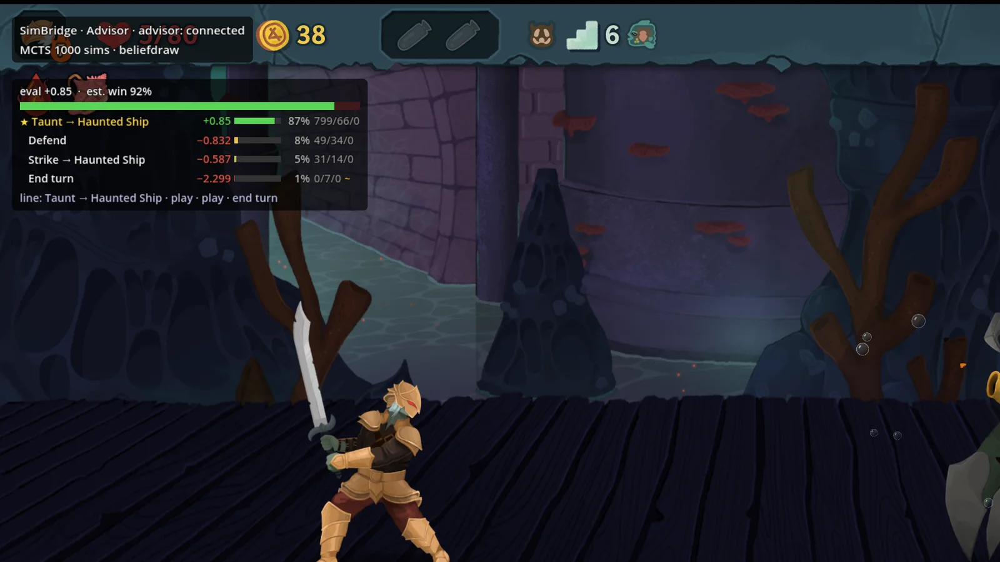
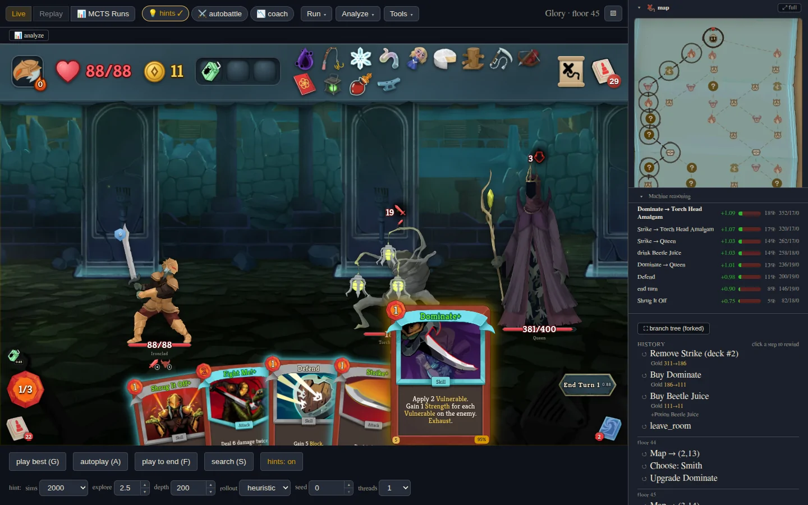

# sts2-sim

[](https://github.com/tfriedel/sts2-sim/actions/workflows/ci.yml)
[](https://tfriedel.github.io/sts2-sim/)

**A bit-exact re-implementation of Slay the Spire 2, an AI that plays it, and
the tools to watch, question and argue with that AI — in a browser tab or
inside the real game.**



<sub>The Spire Coach mod inside the real game: 1,000 MCTS simulations rank
every legal move, show the principal line and estimate the win chance —
recomputed on every decision.</sub>

## What's here

- **A from-scratch Rust engine for the whole game.** All five characters,
  ~580 cards, ~300 relics, the potions, powers, monsters, events and all
  three acts, pinned to game build v0.107.1 — down to a hand port of .NET's
  `System.Random`, so the same seed produces the same map, the same
  rewards and the same shuffles as the real game.
- **Proven against the real game code, not eyeballed.** A headless harness
  runs the game's own C# assembly in lockstep with the Rust engine and
  compares the full state after every action. All five characters reached
  **zero combat divergences**, and whole-run parity is clean across all five.
- **Fast.** ~1.4M state transitions/s and ~100k random-play combats/s on one
  core — about **7,000× faster than driving the game's own logic headless**.
  A 1,000-simulation MCTS search takes ~25 ms.
- **An AI that wins.** Chance-node MCTS for every fight, plus a PPO-trained
  transformer per character for every other decision: paths, card picks,
  shops, events, rest sites, removals and upgrades. In the simulator the
  Ironclad champion wins **71%** of runs pooled over Ascension 0–10 (**90%**
  at A0). In the **real game**, playing unassisted at **Ascension 8**, the
  August 2026 versions won 13 of 40 Ironclad runs and 11 of 40 Silent runs.
  Explained in depth: [how the AI plays](https://tfriedel.github.io/sts2-sim/ai.html)
  and [how it's trained](https://tfriedel.github.io/sts2-sim/training.html).
- **A browser workbench.** The engine compiled to WebAssembly, with the
  game's look: play a seed, rewind any decision, branch, ask the AI for a
  hint, see its search tree, watch the PPO champion play a whole run, then
  review where the run was won and lost. A static site that runs offline —
  no server.
- **The Spire Coach mod for the real game.** Turns the same AI into an in-game
  coach (ranked moves, card scores, route advice, win chance), an autopilot
  that plays whole runs, and a bit-exact rewind button.
- **Bring-your-own-game tooling.** One command, `just import-game`,
  decompiles your copy of the game and extracts its art, audio and data; the
  same pipeline can generate a full static wiki.

## Numbers

| | |
|---|---|
| Engine coverage | 5 characters · 580 card ids · 297 relics · 63 potions · 272 powers · 121 monsters · 69 events · 4 act models |
| Parity vs the game's C# | zero combat divergences on every character; whole-run parity 250/250 seeds across all five; a 5,000-seed fuzz tier |
| Throughput (one core) | ~1.4–1.5M transitions/s · ~100–110k combats/s · ~7,000× the headless game |
| MCTS | 1,000 sims ≈ 25 ms native, one thread · the same in a tablet browser via WASM (≈ 2× native cost on the same machine) · up to ~49k sims/s multi-threaded |
| Code | ~360k lines of Rust · ~116k Python · ~56k TypeScript · 7,000+ Rust tests, 3,000+ Python, 1,400+ web |

**Run-AI champions** (simulator, MCTS combat at 1,000 sims, 4,000 at bosses;
each promoted on a pre-registered gate of 2,200 paired runs, 200 seeds ×
A0–A10):

| Character | A0 | A4 | A8 | A9 | A10 | Pooled A0–A10 | Gain over previous champion |
|---|---|---|---|---|---|---|---|
| Ironclad | 90.5% | 84.5% | 66.0% | 34.0% | 7.5% | **71.0%** | +5.2 pp, p = 1e-6 |
| Defect | 81.5% | 76.5% | 53.0% | 21.5% | 11.5% | **63.6%** | +5.5 pp, p = 2e-6 |
| Silent | 71.5% | 68.0% | 40.5% | 18.0% | 6.0% | **52.5%** | +5.6 pp, p = 7e-7, all 11 levels up |
| Regent | 70.0% | 62.5% | 42.5% | 18.0% | 5.5% | **50.6%** | +4.6 pp, p = 1e-4 |
| Necrobinder | 50.0% | 40.5% | 23.0% | 5.0% | 3.5% | **33.1%** | +6.8 pp, p = 6e-10, all 11 levels up |

200 runs per cell; every level is in the
[docs](https://tfriedel.github.io/sts2-sim/#ai).

**In the real game** (the mod's advisor driving `SlayTheSpire2.exe`, 40 runs
each, random seeds, no cheats, 8,000 sims per combat decision, August 2026
champions): Ironclad A8 **32.5%**, Silent A8 **27.5%**.

## The browser workbench



A React front end over the Rust engine compiled to WebAssembly, running in a
Web Worker; saves live in IndexedDB, and it installs as an offline PWA.

- **Play** any character, seed and ascension, with the real card text and —
  after `just import-game` — the real art and sound.
- **Rewind and branch** any decision; the run tree keeps every fork.
- **Ask the AI** for a combat hint, open the MCTS search tree, rank the
  choices on a card reward, shop or event, or let it play the best line.
- **Watch the PPO champion** play a run to the end; take over at any point.
- **Review** a finished run: regret per decision and a win-probability chart.
- **Lab tools**: replay viewer, MCTS-runs browser, deck analysis, a SimLab
  sandbox for seed-paired strategy studies, and *state import* — paste a
  position copied from the live game and analyse it here.

## Spire Coach — the AI inside the real game


A C# mod for Slay the Spire 2 ([`sts2-bridge/`](sts2-bridge/)) that connects
the running game to the AI stack over a local socket. An idle mod leaves the
game vanilla.

- **Advisor mode** — you play; the mod shows ranked moves with MCTS
  statistics, card-reward and shop scores, the recommended map route and
  an estimated win chance.
- **AI turns** — `F6` lets the AI take one decision, `F7` lets it play until
  you stop it. Autopilot plays whole runs unattended.
- **Rewind** — every room entry is snapshotted with its RNG state, so you can
  undo a combat turn (`Ctrl+Z`), restart a room, or go back to any earlier
  room — bit-exact, including fights already finished.
- **Workbench link** — open the current game state in the workbench, browse
  the live game's tree and rewind the real game from the page.
- A toolbar, an in-game help panel (`F1`), an action log, speed controls and
  a settings page.

Build, install and protocol: [`sts2-bridge/README.md`](sts2-bridge/README.md),
[`sts2-bridge/PROTOCOL.md`](sts2-bridge/PROTOCOL.md).

## How it fits together

| Subproject | Language | What it is |
|---|---|---|
| [`sts2-rs/`](sts2-rs/) | Rust | The engine, MCTS, run-AI with ONNX policy inference, CLI, PyO3 bindings, and the workbench's engine layer (WASM). Builds and tests with nothing else present. |
| [`sts2-pycli/`](sts2-pycli/) | Python + C# + TS | The integration hub: the headless C# harness around the game assembly (your copy) that serves as the parity oracle, the parity suite, PPO training, the workbench web app, the real-game advisor, and an MCP server so an LLM can play. |
| [`sts2-bridge/`](sts2-bridge/) | C# | The Spire Coach mod. |
| [`sts2-wiki/`](sts2-wiki/) | Python / Astro | Extraction tooling: decompiles your game copy, extracts data, art and sound, and can generate a static wiki. |
| `scripts/import_game.py` | Python | `just import-game` — produces every game-derived input from your install. |

Architecture: [ARCHITECTURE.md](ARCHITECTURE.md). Full documentation with
screenshots: **[tfriedel.github.io/sts2-sim](https://tfriedel.github.io/sts2-sim/)**
(source in [`docs/site/`](docs/site/)).

## What's in the box, and what isn't

> Slay the Spire 2 is © Mega Crit; this project is not affiliated with or
> endorsed by them. The repository carries the game's **text and extracted
> data**, so the engine, the AI and the workbench work out of the box, but
> **no art, audio, game assemblies or decompiled code**. The tooling extracts
> those from **a copy of the game you own**
> ([docs/bring-your-own-game.md](docs/bring-your-own-game.md)) into
> git-ignored paths. See [NOTICE](NOTICE) and [PROVENANCE.md](PROVENANCE.md).

## Quickstart

Three tiers; each needs more than the last. Prerequisites and details:
[docs/bring-your-own-game.md](docs/bring-your-own-game.md).

**Engine only — no game needed.** Rust 1.96 (pinned by
`sts2-rs/rust-toolchain.toml`), `cargo-nextest`, `just` (1.38+). `sccache` is
optional — `export RUSTC_WRAPPER=sccache` to use it.

```sh
just rs-check      # cargo check --workspace --all-targets
just rs-test       # cargo nextest run --workspace  (never bare `cargo test`)
just rs-doc-test   # cargo test --workspace --doc   (nextest cannot run doctests)
```

**Oracle — the C# parity harness.** Add the game, the .NET 9 SDK, `uv`.

```sh
just import-game /path/to/Slay\ the\ Spire\ 2 --tier oracle
cd sts2-pycli && uv sync --dev && just build-cs && uv run pytest tests
```

**Workbench with real art (and the decompiled source).** Add `ilspycmd`,
Node 20+, the wasm target and a `wasm-bindgen` CLI matching the crate
(`rustup target add wasm32-unknown-unknown`,
`cargo install wasm-bindgen-cli --version 0.2.120`).

```sh
just import-game /path/to/Slay\ the\ Spire\ 2   # tier = workbench
just workbench-local                              # build + serve on http://127.0.0.1:4173
```

`workbench-local` builds `sts2-pycli/web/dist` (the engine runs in the
browser as wasm — no backend) and serves it on this machine only.
`cd sts2-pycli && just workbench` is the Python-backed alternative on :8077.

**Please run the workbench locally and don't host it publicly.** With real
art the build contains the game's images and sound, extracted from your copy
for your own use. The servers bind to `127.0.0.1` by default; `STS2_HOST`
(Python servers) and `STS2_WEB_HOST` (Vite) open them to your LAN.

Without the game the workbench still builds and runs with the real card
text; every image is a neutral placeholder tile and there is no sound until
`just import-game` extracts the art (and, with the FMOD SDK, the audio).

**The mod.** Windows, the game at v0.107.1, the .NET 9 SDK and
[BaseLib](https://github.com/Alchyr/BaseLib-StS2):
`cd sts2-bridge && dotnet build` builds it and installs it into the game's
`mods/` folder; details in [`sts2-bridge/README.md`](sts2-bridge/README.md).

## Windows

The engine tier works from PowerShell: the root `justfile` runs its recipes
under PowerShell on Windows, so `just rs-check`, `just rs-test` and
`just rs-doc-test` work as-is (needs VS Build Tools for the linker —
[BUILDING-WINDOWS.md](BUILDING-WINDOWS.md)). The subproject justfiles,
`import-game` and the workbench build are bash: use **WSL2** for those
(point `import-game` at the game through `/mnt/c/...`; a server in WSL2 on
`127.0.0.1` is normally reachable from the Windows browser at the same
address).

## Testing

- Rust: `cargo nextest run --workspace` **and** `cargo test --workspace --doc`
  from `sts2-rs/`. Bare `cargo test` shares one process across tests and
  produces order-dependent false failures here. Game-dependent tests skip
  when the game data is absent.
- Python: `uv run pytest tests` from `sts2-pycli/`. Tests that need the C#
  oracle carry the `oracle` marker and skip without `lib/sts2.dll`;
  `-m "not oracle"` is the game-free subset CI runs.
- Web: `npm test` from `sts2-pycli/web/` (vitest); suites that need the
  extracted audio/art skip without them.

## Contributing

[CONTRIBUTING.md](CONTRIBUTING.md) — including how this repository relates
to the private development repo it is synced from.

## Credits

- `sts2-pycli` began as a fork of [wuhao21/sts2-cli](https://github.com/wuhao21/sts2-cli)
  by Hao Wu (MIT).
- Spire Coach started as a port of zhiyue's STS2BridgeMod from
  [zhiyue/sts2-rl-agent](https://github.com/zhiyue/sts2-rl-agent).
- The mod's settings page uses Alchyr's
  [BaseLib](https://github.com/Alchyr/BaseLib-StS2).

## License

MIT — [LICENSE](LICENSE); `sts2-rs/`, `sts2-pycli/`, `sts2-bridge/` and
`sts2-wiki/` carry their own MIT files. The grant covers the original work
only; nothing from the game is licensed or included.
